<div align="center">

# 🏢 Agent Office (Ajan Ofisi)

**A fully local app that shows the Claude Code sessions and sub-agents running on your computer as characters in
DevTechnic's live 3D office.**


[Türkçe](README.md) · [Roadmap (TR)](PLAN.md) · [Log format (TR)](docs/veri-bicimi.md)

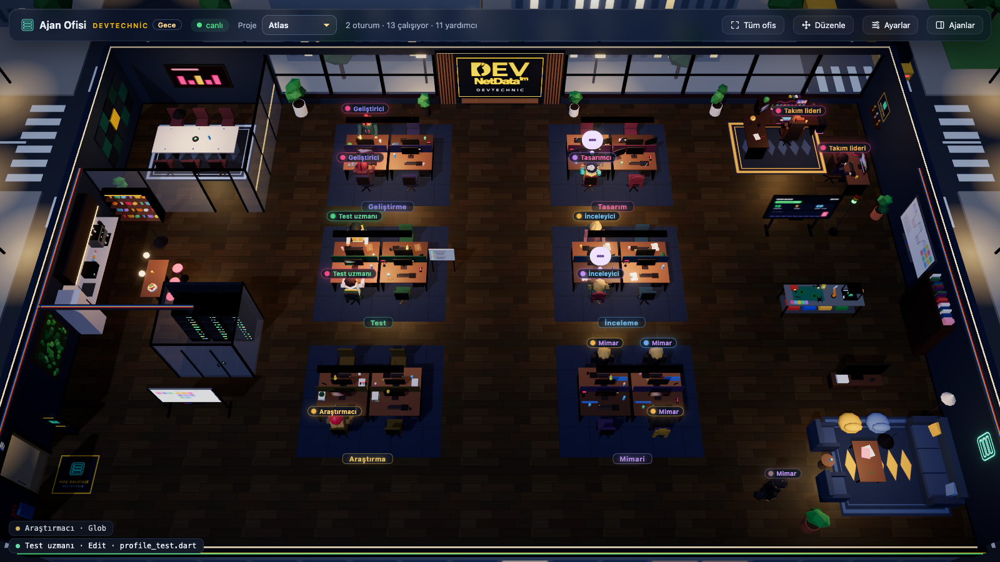

</div>

> The user interface is in Turkish. This document is an English overview; the Turkish [README](README.md) is the
> primary, most detailed reference.

## What is it?

While working with Claude Code it is hard to see what is happening in the background: which session is doing what,
which sub-agent just started, who messaged whom, who is waiting for your answer? **Agent Office** turns this into a
living office by **only reading** the log files Claude Code writes to your machine (`~/.claude`):

- Every Claude Code session becomes a **team lead**; every sub-agent it spawns becomes a **team member**.
- Characters act out what they are doing right now: thinking, writing, reading, using the terminal, walking over to
  a colleague, grabbing coffee, reporting back.
- Each project gets its own office; the **All projects** view shows projects as small glass-walled rooms.

No data ever leaves your computer, and message, code and command contents are never displayed.

## Screenshots

> All screenshots were taken with `npm run demo` using **fake** data.

| **DevTechnic brand wall**                                    | **Lounge**                                                                  |
| ------------------------------------------------------------ | --------------------------------------------------------------------------- |
| 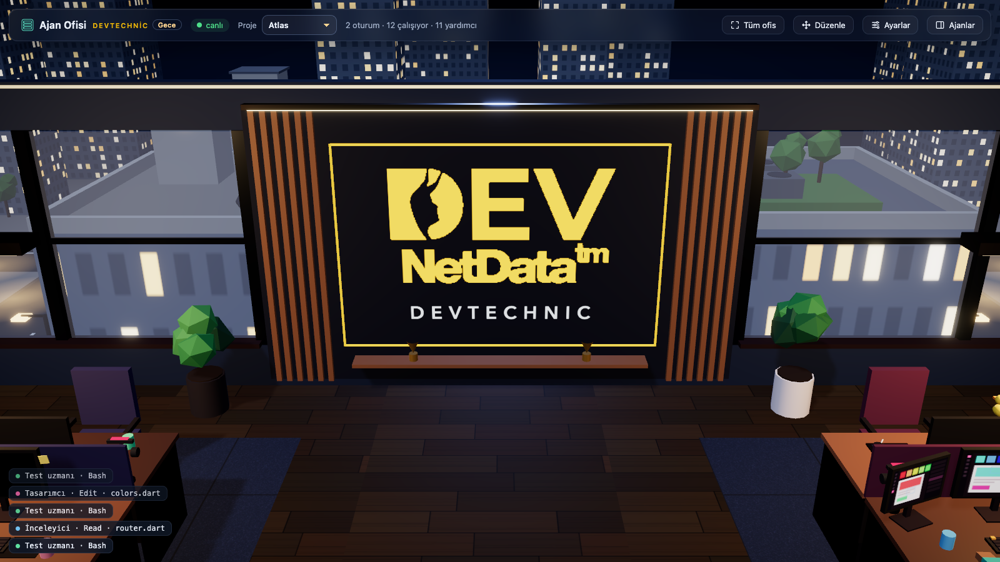       | 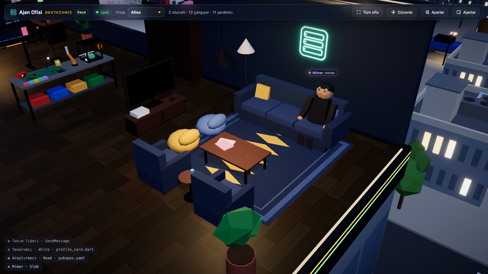                        |
| **Project office with agent panel**                          | **Agent details (camera follow)**                                           |
| 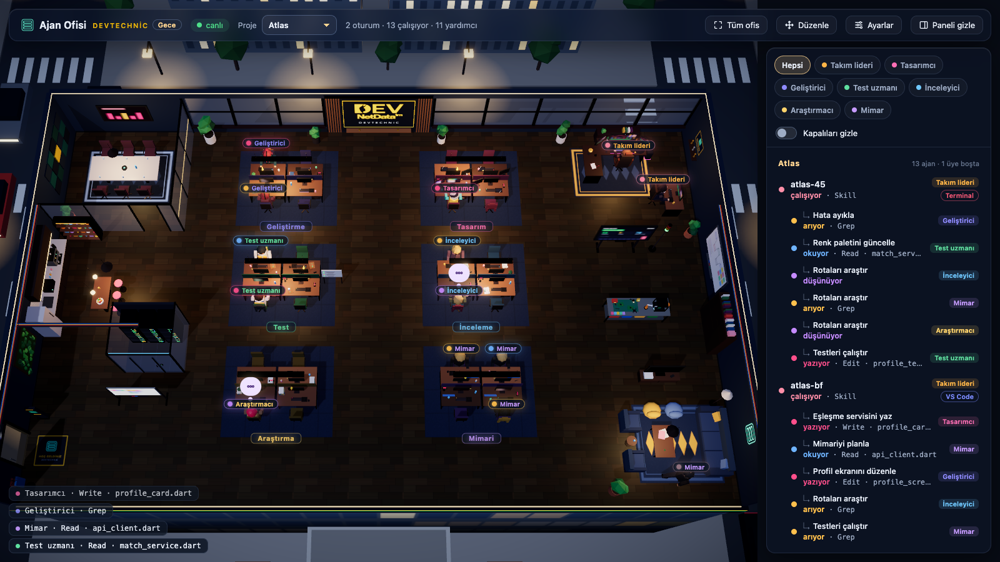       | 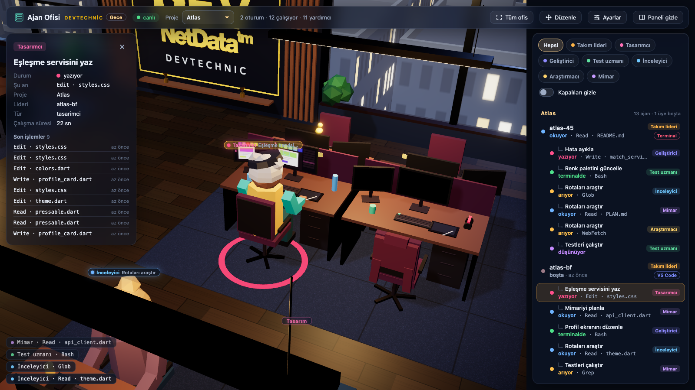                    |
| **All projects**                                             | **Layout editor**                                                           |
| 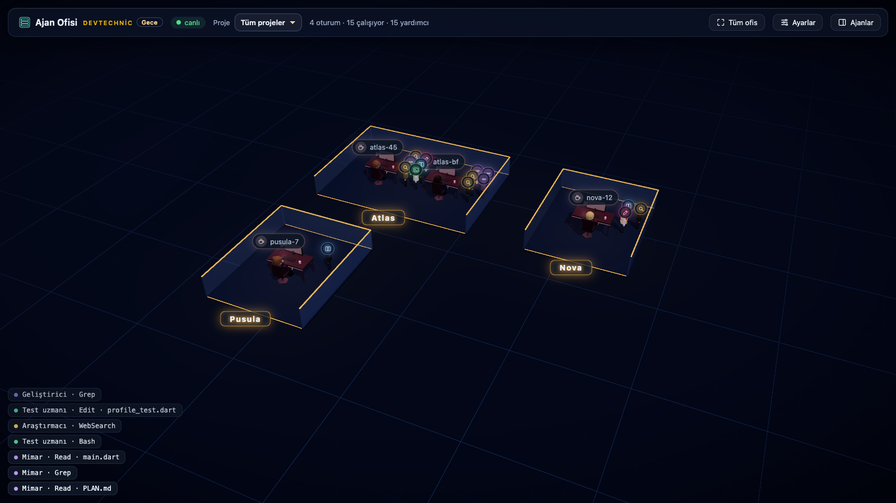     | 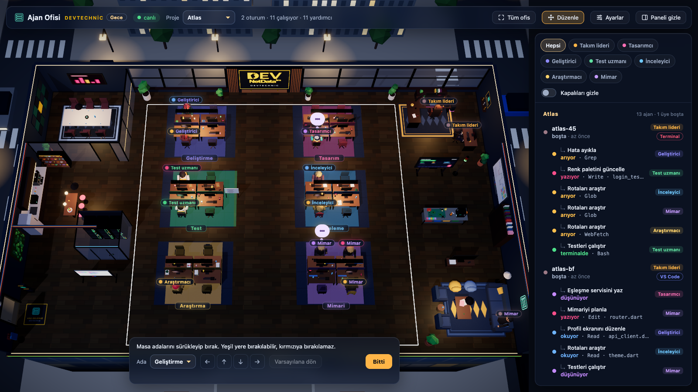              |
| **Daylight theme**                                           | **Nordic theme**                                                            |
| 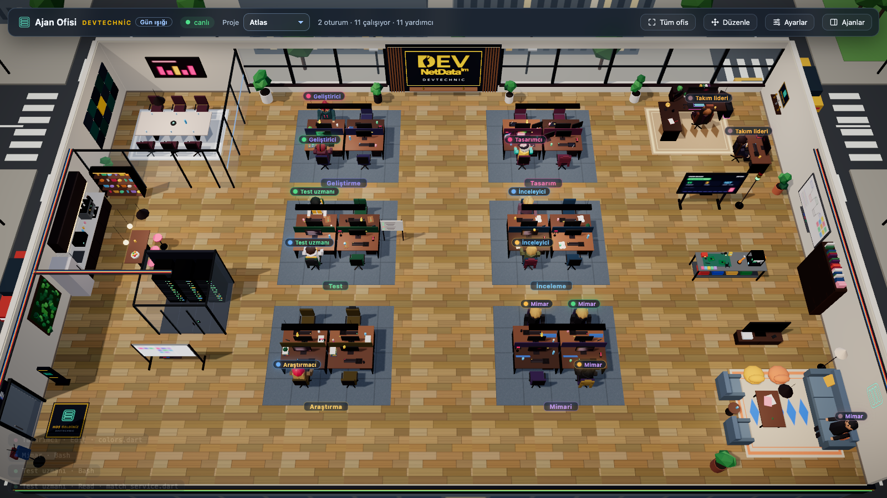 | 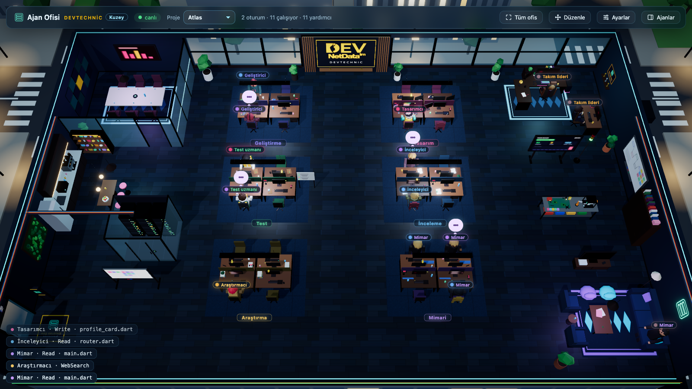                      |
| **Settings**                                                 | **Phone width**                                                             |
| 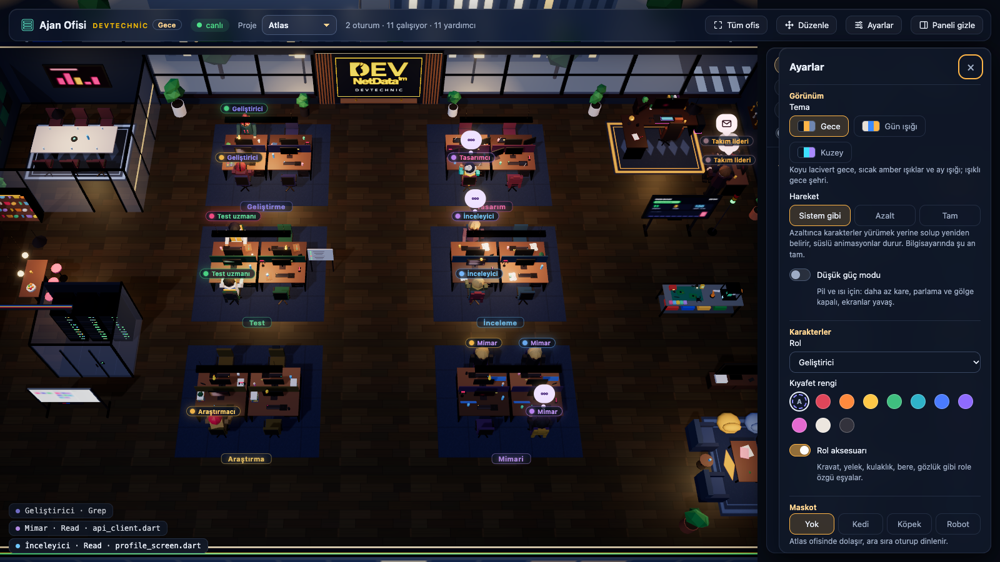              | 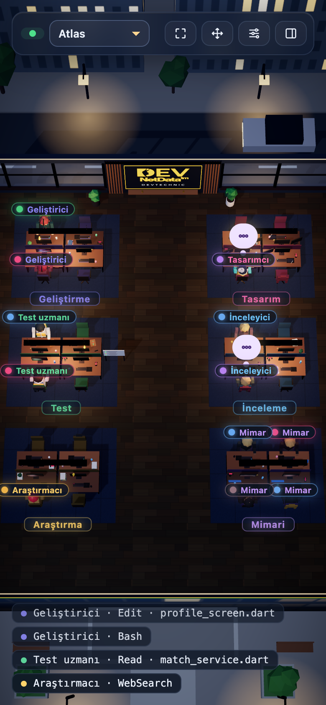 |

## Features

- **DevTechnic office (v3):** a brand wall with a backlit gold DevTechnic logo, the office as one floor of a tower
  (navy floor slab, lit lower floors, city below), acoustic panels and a conference phone in the meeting room, tiles
  and a fruit bowl in the kitchen, armchairs, a bean bag and a teal neon sign in the lounge, a brand plaque in the
  lead's corner and a welcome mat and totem at the entrance. Framing adapts to the screen's aspect ratio so the
  office fills wide screens, the area left when the panel is open and, on phones, the work area.
- **City:** the tower sits on a city block with roads, crosswalks, street trees and lamps (soft light pools at night),
  a park with a pond, a car park, a fountain plaza and moving traffic (headlights and tail lights at night). Nearby
  buildings stay below the office floor and have rooftop AC units, water tanks, solar panels, roof gardens or a
  helipad; taller buildings form a skyline further out.
- **Project office:** role-based desk islands (Development, Design, Test, Review, Research, Architecture), a lead's
  corner, glass meeting room, kitchen / coffee corner, whiteboard, bookshelf, lounge (sofa, armchairs and a game corner
  with a TV and console), large windows and a city view. Agents defined in the project's `.claude/agents/*.md` have
  their own desks and stay in the office even when idle; when work arrives the same character returns to its desk,
  and after reporting back it stays (idle characters exist only in the scene and show as "idle" in the list).
- **Roles and characters:** the main session is always the _Team lead_; sub-agent roles come from their type
  (`tasarimci`/designer, `testci`/tester, `code-reviewer`, `Explore` → researcher, `Plan` → architect,
  `general-purpose` → developer) or are inferred from behaviour. Articulated low-poly characters with role outfits.
- **Live behaviour:** sub-agents walk in through the door, get a task from the lead, work at their desk, report back
  and leave. Same-project messages make characters walk over; cross-project messages show a **flying letter**.
  Thought bubbles, waving when waiting for you. **Living office:** idle characters watch videos or play games at
  their desk (the monitor shows it), play the console together in the game corner, relax on the sofa or armchairs,
  grab coffee, stretch and tinker at the lab bench; when work arrives they drop everything and head back. **A\***
  pathfinding.
- **Live tech props:** a glass **server room** whose rack LEDs blink with the share of busy agents, a **wall
  dashboard** (busy / idle counts, actions over the last 10 minutes, clock), a **build light** plus an **LED strip** on
  the floor band (green: all good, yellow: waiting for you, red: an agent hit an error), a **kanban board** (a working
  agent's note sits in "In progress" and slides to "Done" when finished) and a **"Today in the office"** screen above
  the door. Only counts, colours, roles and names are shown, never content, file names or commands.
- **Tech-company details:** lab bench (3D printer, robot arm, soldering station, drone), espresso machine and snack
  shelf, moss wall, ceiling cable trays; mechanical keyboards, rubber ducks, headphone stands, stickered laptops and
  hoodies on chairs.
- **Fake monitors:** animated canvas screens per activity (scrolling code, terminal, search, palettes, test ticks).
  No real content.
- **Interaction:** orbit / zoom / pan, click to follow a character, detail panel with the last 20 actions, role
  filters, "hide offline", live activity feed ("Designer · Edit · theme.dart").
- **Customisation:** drag-and-drop layout editor (0.5 m grid, keyboard support, saved per project), three themes
  (Night, Daylight, Nordic), outfit colours and accessories per role, a mascot per project (cat, dog, robot).
- **Comfort:** sound alerts generated in code (no downloads), low-power mode, reduced-motion support, rendering
  slows down when unfocused and stops when the tab is hidden.

## Privacy and security

| Rule                     | How                                                                                                                |
| ------------------------ | ------------------------------------------------------------------------------------------------------------------ |
| Read-only                | Nothing under `~/.claude` is ever written, deleted or moved                                                        |
| Data stays local         | Server and UI listen on `127.0.0.1` only; WebSocket connections from other origins are rejected                    |
| Secrets are never opened | `~/.claude/sessions/*.key` files are filtered by name and never opened                                             |
| No identity data         | `session-owner`, `api-request*` lines and account IDs are skipped while parsing                                    |
| No content               | Messages, thinking, code, command text and full paths are never read out or sent; only tool type and file **name** |
| Screen sharing           | "Hide file names" and "Show session titles" switches in Settings                                                   |
| Offline                  | Nothing is downloaded at runtime (fonts, textures and sounds included)                                             |
| Team files               | Only the front-matter block of `.claude/agents/*.md` is read (max 4 KB)                                            |

Tests run against **fake** data in [`fixtures/`](fixtures/), never real logs.

## Getting started

**Requirements:** [Node.js](https://nodejs.org/) 22+ and Claude Code in use on the same machine.

```bash
git clone https://github.com/zinkxx/agent-office.git
cd agent-office
npm install
npm start        # starts server + UI and opens the browser
```

The UI opens at **http://127.0.0.1:5174**.

```bash
npm run demo                                          # lively fake office (3 projects), reads no files
AJAN_OFISI_CLAUDE_HOME=fixtures/claude-home npm start # static sample logs
```

## Scripts and environment

| Command               | Description                                                            |
| --------------------- | ---------------------------------------------------------------------- |
| `npm start`           | Starts the server (5175) and UI (5174)                                 |
| `npm run demo`        | Crowded demo office with fake data                                     |
| `npm test`            | Runs the tests (Vitest)                                                |
| `npm run typecheck`   | Type-checks server and UI                                              |
| `npm run check`       | Type-check + tests                                                     |
| `npm run format`      | Formats the code with Prettier                                         |
| `npm run screenshots` | Regenerates README screenshots (headless Chrome, needs a running demo) |

| Variable                 | Default     | Description                                             |
| ------------------------ | ----------- | ------------------------------------------------------- |
| `AJAN_OFISI_PORT`        | `5175`      | Server port                                             |
| `AJAN_OFISI_WEB_PORT`    | `5174`      | UI port                                                 |
| `AJAN_OFISI_NO_OPEN`     | —           | `1` = don't open the browser                            |
| `AJAN_OFISI_DEMO`        | —           | `1` or `dolu` (crowded): fake demo office               |
| `AJAN_OFISI_CLAUDE_HOME` | `~/.claude` | Alternative Claude folder (e.g. `fixtures/claude-home`) |

## Architecture

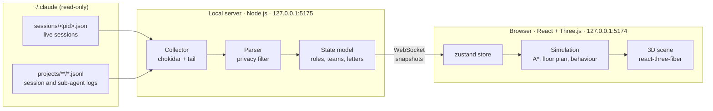

- **Tailing:** log files can exceed 40 MB; only the last ~256 KB is read on start-up, then only appended lines are
  processed in 1 MB chunks.
- **Defensive parsing:** broken, partial or unknown lines are skipped; the server never crashes on bad input.
- **Pure simulation:** pathfinding, floor plan and behaviour are React-free, unit-tested modules; React only renders.
- **Performance:** repeated furniture is drawn with `InstancedMesh`; ~119 FPS with 13 characters on an Apple M1.

**Stack:** Node.js 22, TypeScript (strict), `ws`, `chokidar`, Vite, React 19, Three.js, `@react-three/fiber`,
`@react-three/drei`, `@react-three/postprocessing`, zustand, Vitest, Prettier.

## Project layout

```
server/    Local server: watches logs, computes state, streams to the browser
web/       Browser UI (React + Three.js); 3D scene in web/src/office
shared/    Types shared by server and UI
fixtures/  Fake Claude folder and team list for tests
scripts/   Helper scripts (README screenshots)
docs/      Documentation and screenshots
PLAN.md    Roadmap and progress log (Turkish)
CLAUDE.md  Working rules for Claude Code (Turkish)
```

## Development

```bash
npm run check   # type-check + tests
```

GitHub Actions runs `npm run check` and a production UI build on every push to `main` and on pull requests.

## Roadmap

- [x] Reader, privacy filter, state model, live streaming
- [x] 3D project office, role characters, pathfinding, live behaviour
- [x] Interaction, settings, themes, layout editor, mascots
- [x] Performance, memory pruning, low-power mode, accessibility
- [x] **v3 · DevTechnic office:** brand wall and sign, visual upgrade of every area, full-viewport office
- [ ] Optional desktop app (Tauri/Electron) or VS Code panel

---

<div align="center">
<sub>The Claude Code log format is not an official, documented Anthropic interface and may change between Claude
Code versions.</sub>
</div>
