<div align="center">

# 🏢 Ajan Ofisi

**Claude Code oturumlarının ve yardımcı ajanlarının canlı 3B bir ofiste çalışmasını izle — %100 yerel, hiçbir veri bilgisayarından çıkmaz.**


[](https://github.com/zinkxx/agent-office/actions/workflows/check.yml)
[](https://github.com/zinkxx/agent-office/releases/latest)
[](https://github.com/zinkxx/agent-office/issues)
[](LICENSE)
[](https://zinkxx.github.io/agent-office/)


[English](README.md) · **Türkçe** · [Yol haritası](PLAN.md) · [Kayıt biçimi](docs/veri-bicimi.md) ·
[Sürüm 3 tasarımı](docs/tasarim-v3.md)

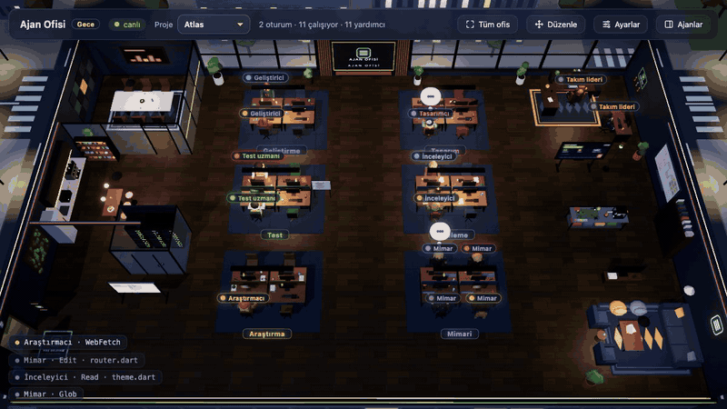

**[Canlı demoyu dene](https://zinkxx.github.io/agent-office/)**

</div>

---

## İçindekiler

- [Nedir?](#nedir)
- [Ekran görüntüleri](#ekran-görüntüleri)
- [Özellikler](#özellikler)
- [Gizlilik ve güvenlik](#gizlilik-ve-güvenlik)
- [Kurulum ve çalıştırma](#kurulum-ve-çalıştırma)
- [Kullanım](#kullanım)
- [Komutlar ve ortam değişkenleri](#komutlar-ve-ortam-değişkenleri)
- [Mimari](#mimari)
- [Proje yapısı](#proje-yapısı)
- [Geliştirme ve testler](#geliştirme-ve-testler)
- [Yol haritası](#yol-haritası)
- [Katkı](#katkı)

## Nedir?

Claude Code ile çalışırken arka planda neler olduğunu görmek zordur: hangi oturum ne yapıyor, hangi yardımcı ajan
(alt ajan) başladı, kim kime mesaj attı, kim senden cevap bekliyor? **Ajan Ofisi**, Claude Code'un bilgisayarına
yazdığı kayıt dosyalarını (`~/.claude`) **yalnızca okuyarak** bu bilgiyi canlı bir ofise dönüştürür:

- Her Claude Code oturumu bir **takım lideri**, başlattığı her yardımcı ajan bir **ekip üyesi** olur.
- Karakterler o anda yaptıkları işe göre davranır: düşünür, yazar, okur, terminal kullanır, toplantıya gider, kahve
  alır, rapor verir.
- Her proje kendi ofisinde çalışır; **Tüm projeler** görünümünde projeler cam duvarlı küçük odalar olarak yan yana
  durur.

Hiçbir veri bilgisayarından dışarı çıkmaz; mesaj, kod ve komut içerikleri hiçbir zaman gösterilmez.

## Ekran görüntüleri

> Tüm görüntüler `npm run demo` ile, **uydurma** verilerle alınmıştır.

| **DevTechnic marka duvarı**                                    | **Dinlenme alanı**                                                                |
| -------------------------------------------------------------- | --------------------------------------------------------------------------------- |
| 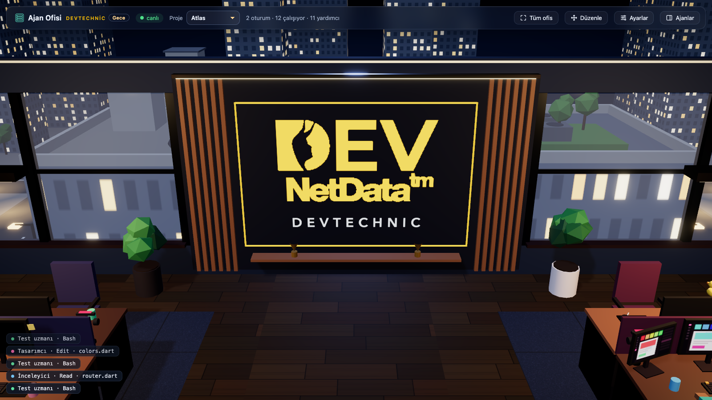       | 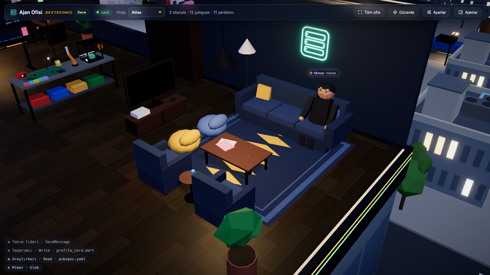                      |
| **Proje ofisi ve ajan paneli**                                 | **Ajan ayrıntıları (kamera takibi)**                                              |
| 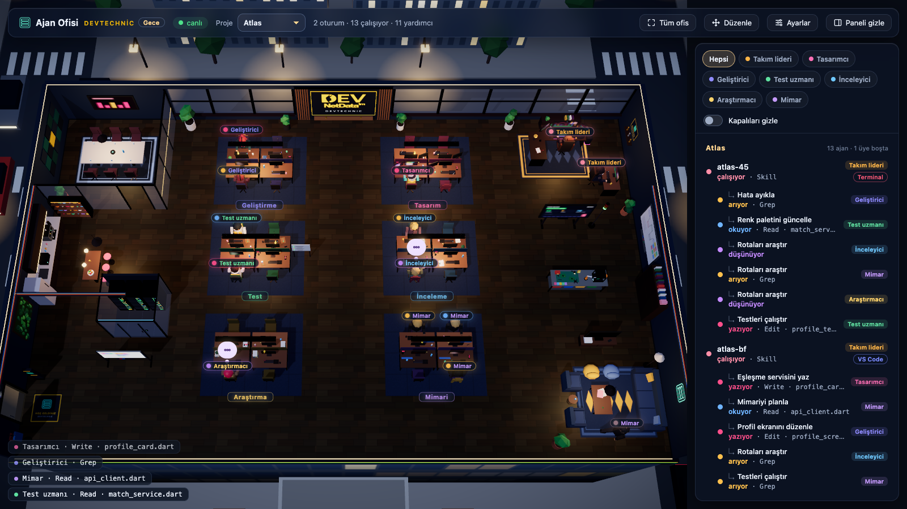    | 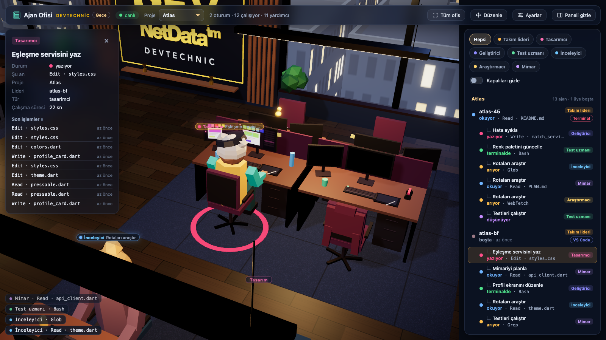                          |
| **Tüm projeler**                                               | **Düzen düzenleyicisi**                                                           |
| 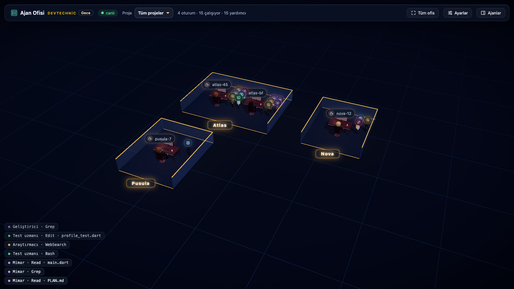       | 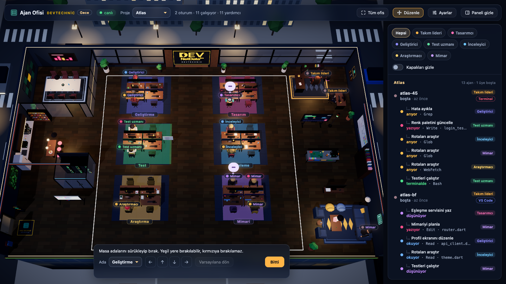                |
| **Gün ışığı teması**                                           | **Kuzey teması**                                                                  |
| 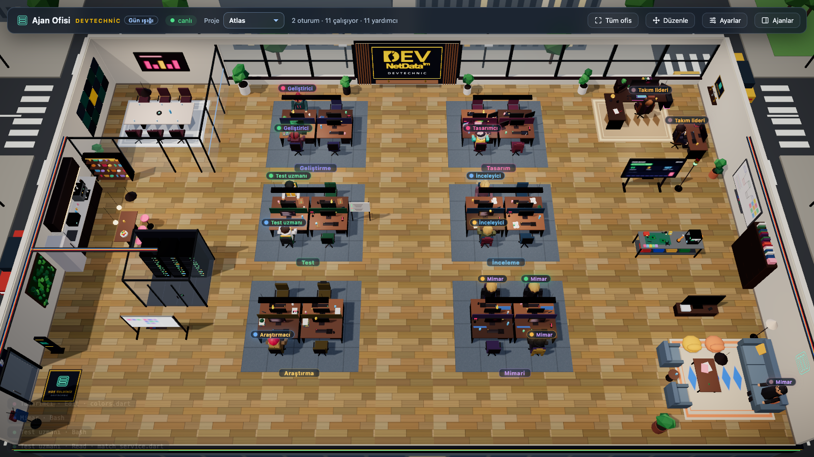 | 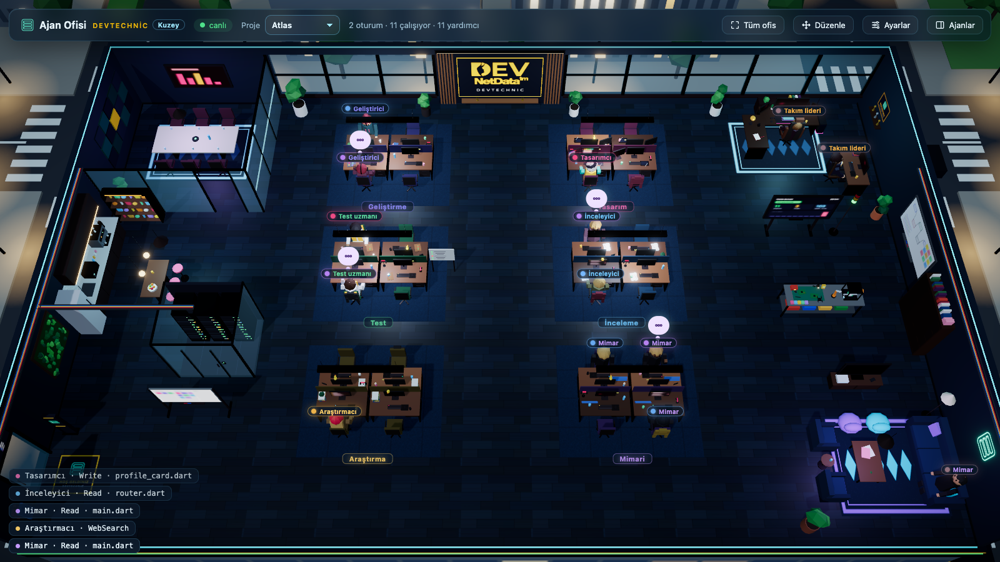                            |
| **Ayarlar**                                                    | **Telefon genişliği**                                                             |
| 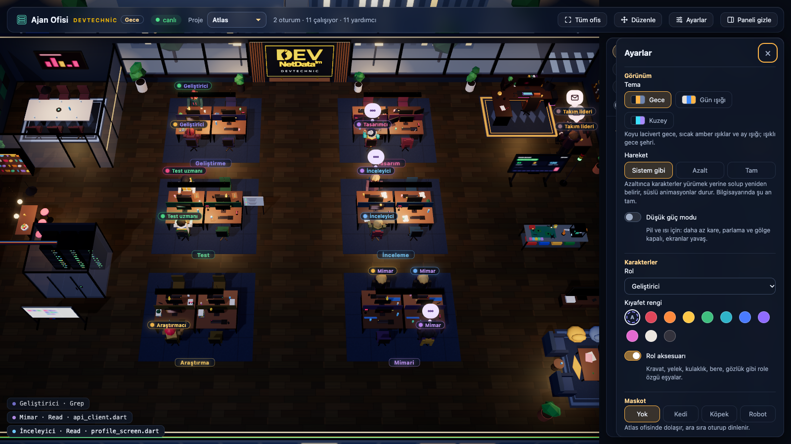                 | 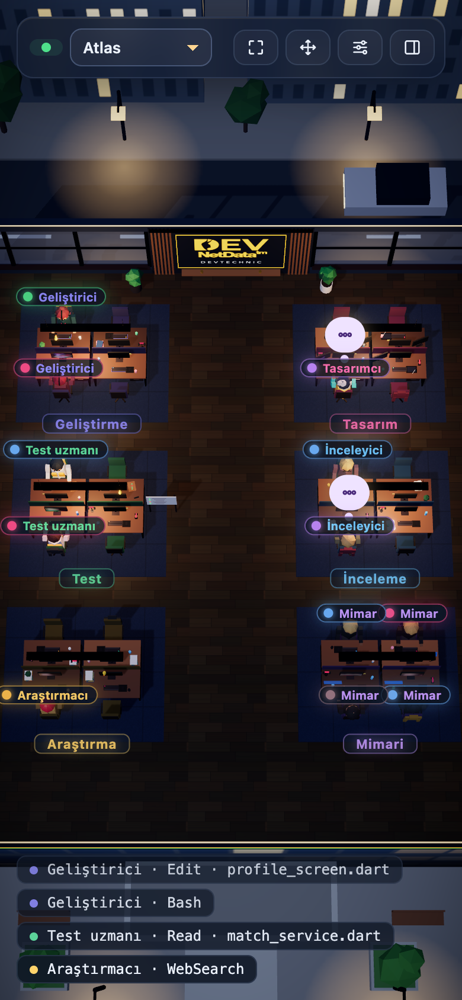 |

## Özellikler

- **Dil:** Türkçe ve İngilizce arayüz (3B ofisteki tabela ve ekranlar dahil). Varsayılan tarayıcı diline göre
  seçilir; Ayarlar'dan istediğin an değiştirebilirsin.
- **Marka ayarı:** varsayılan olarak sade ve nötr; Ayarlar'dan DevTechnic markası (duvar, logo, plaket) seçilebilir.

### 🏢 DevTechnic ofisi (Sürüm 3)

- Arka duvarın ortasında **marka duvarı**: lacivert panel, ahşap çıtalar, ışıklı altın DevTechnic logosu ve yazısı.
- Ofis bir kulenin katı: odanın altında lacivert **kat bandı** ve alt katların ışıklı cephesi, şehir aşağıda.
- **Şehir:** kule bir blokta, etrafında yollar, yaya geçitleri, kaldırım ağaçları ve sokak lambaları (gece yerde
  yumuşak ışık havuzları), park ve gölet, otopark, fıskiyeli meydan, yollarda dolaşan arabalar (gece farlar ve stop
  lambaları yanar). Yakındaki binalar ofisten alçaktır; çatılarında klima, su deposu, güneş paneli, çatı bahçesi ya da
  helikopter pisti vardır. Uzakta yüksek binalardan bir silüet.
- **Toplantı odasında** akustik paneller ve konferans telefonu; **mutfakta** karo, mikrodalga, meyve kâsesi;
  **dinlenme alanında** koltuklar, armut koltuk ve camgöbeği neon simge; **lider köşesinde** marka plaketi ve ödül
  rafı; **girişte** "Hoş geldiniz" paspası, karşılama totemi ve portmanto.
- **Kadraj** ekranın en-boy oranına göre seçilir: ofis geniş ekranı, panel açıkken kalan alanı ve dar ekranda
  çalışma alanını doldurur.
- Marka renkleri (altın `#eab308`, lacivert `#0f172a`, camgöbeği `#64ffda`) her temada aynı kalır; logo ve simge
  yerel dosyalardan çizilir.

### 🏢 Proje ofisi

- Rollere göre **masa adaları** (Geliştirme, Tasarım, Test, İnceleme, Araştırma, Mimari), **lider köşesi**, cam
  duvarlı **toplantı odası**, **mutfak / kahve köşesi**, **beyaz tahta**, **kitaplık**, **dinlenme alanı** (kanepe,
  koltuklar, TV ve oyun konsollu oyun köşesi), büyük
  pencereler ve dışarıda **şehir manzarası**.
- **Ekip listesi:** projede `.claude/agents/*.md` ile tanımlı ajanların masaları vardır; üyeler çalışmıyorken de
  ofistedir ve boşta dolaşır. Üyeye iş gelince aynı karakter masasına döner, iş bitince lidere rapor verir ve ofiste
  kalır. (Bu boştaki karakterler yalnızca sahnededir; listede "boşta" görünürler, tıklanmazlar.)
- **Monitörler** duruma göre canlanır (tamamen sahte çizimler): kayan kod satırları, kayan sayfa, yeşil terminal
  yazıları, büyüteç, renk paletleri, test tikleri.

### 🧑‍💼 Roller ve karakterler

| Rol          | Nereden anlaşılır                                        | Görünüm                                 |
| ------------ | -------------------------------------------------------- | --------------------------------------- |
| Takım lideri | Ana oturum                                               | Ceket, köşe masa, büyük ekran           |
| Geliştirici  | `gelistirici`, `general-purpose`, iş tanımı              | Kapüşon, kulaklık                       |
| Tasarımcı    | `tasarimci` / `designer`                                 | Renkli kıyafet, bere, iki ekran, tablet |
| Test uzmanı  | `testci` / `tester` / `qa`, çoğunlukla test çalıştırması | Yelek, kontrol listesi panosu           |
| İnceleyici   | `inceleyici` / `code-reviewer`, hiç yazmadan okuması     | Gözlük                                  |
| Araştırmacı  | `Explore`, `arastirmaci`                                 | —                                       |
| Mimar        | `Plan`, `mimar`                                          | —                                       |

Karakterler eklemlidir (kalça, diz, omuz); oturma, ayakta durma ve yürüme arasında yumuşak geçiş yaparlar.

### 🎬 Canlı davranışlar

- Yeni yardımcı ajan **kapıdan girer**, rol masasına yürür; lider yanına gidip **iş verir**. İşi bitince lidere
  **rapor verir** ve kapıdan çıkar.
- Aynı projede bir oturum diğerine mesaj atınca onun masasına yürür; projeler arasında **uçan mektup** görünür.
- Düşünürken düşünce balonu; **seni beklerken** ayağa kalkıp sana döner ve el sallar.
- **Yaşayan ofis:** boştaki çalışanlar masasında video izler (ekranda video oynar), bilgisayarda oyun oynar, oyun
  köşesinde armut koltuklara oturup konsolda oynar (TV'de iki kişilik yarış), kanepe ya da koltukta dinlenir, kahve
  alır, gerinir, deney masasında kurcalar. Uzun süre boşta kalan çoğunlukla dinlenme alanına geçer; iş gelince
  elindekini bırakıp masasına döner.
- **Canlı veriye bağlı teknoloji eşyaları:** cam duvarlı **sunucu odası** (dolap ışıkları çalışan oranına göre yanıp
  söner), **duvar panosu** (çalışan / boşta sayıları, son 10 dakikanın işlem grafiği, saat), **derleme lambası** ve
  kat bandında **LED şerit** (yeşil: yolunda, sarı: seni bekliyor, kırmızı: bir ajan hata aldı), **kanban panosu**
  (çalışan ajanın notu "Yapılıyor"da, işi bitince "Bitti"ye kayar), kapının üstünde **"Bugün ofiste"** ekranı.
  Yalnızca sayı, renk, rol ve ad gösterilir; iş içeriği, dosya adı ya da komut gösterilmez.
- **Teknoloji şirketi ayrıntıları:** deney masası (3B yazıcı, robot kol, lehim istasyonu, drone), espresso makinesi ve
  atıştırmalık rafı, yosun duvarı, tavanda kablo kanalları; masalarda mekanik klavye, lastik ördek, kulaklık standı,
  çıkartmalı dizüstü, sandalyede kapüşonlu.
- Karakterler mobilyalara çarpmadan yürür (ızgara üzerinde **A\*** yol bulma).

### 🎛️ Etkileşim ve özelleştirme

- Fareyle döndürme / yakınlaştırma / kaydırma; karaktere tıklayınca **kamera takip eder**, **detay paneli** açılır.
- **Rol filtreleri**, **kapalıları gizle**, köşede **canlı işlem akışı** ("Tasarımcı · Edit · theme.dart").
- **Düzen düzenleyicisi:** masa adalarını sürükle-bırak (0,5 m ızgara, geçerli/geçersiz renkli önizleme, klavye
  desteği, proje başına kayıt).
- **Üç tema:** Gece, Gün ışığı, Kuzey.
- Rol başına kıyafet rengi ve aksesuar; proje başına **maskot** (kedi, köpek, robot).
- **Sesli uyarılar** (kodla üretilir, dosya indirilmez), **düşük güç modu**, **hareketi azalt** desteği.

## Gizlilik ve güvenlik

Bu proje baştan gizlilik kurallarıyla tasarlandı:

| Kural                  | Nasıl sağlanıyor                                                                                                  |
| ---------------------- | ----------------------------------------------------------------------------------------------------------------- |
| Yalnızca okuma         | `~/.claude` altında hiçbir dosyaya yazılmaz, silinmez, taşınmaz                                                   |
| Veri dışarı çıkmaz     | Sunucu ve arayüz yalnızca `127.0.0.1`'de dinler; başka siteden gelen WebSocket bağlantıları reddedilir            |
| Gizli dosyalar açılmaz | `~/.claude/sessions/*.key` dosyaları adından elenir, hiç açılmaz                                                  |
| Kimlik bilgisi yok     | `session-owner`, `api-request*` satırları ve hesap kimlikleri okunurken atlanır                                   |
| İçerik yok             | Mesaj, düşünce, kod, komut metni ve tam yol hiçbir zaman okunmaz/gönderilmez; yalnızca araç türü ve dosya **adı** |
| Ekran paylaşımı        | Ayarlarda **Dosya adlarını gizle** ve **Oturum başlıklarını göster** anahtarları                                  |
| Çevrimdışı             | Uygulama çalışırken internetten hiçbir şey indirmez (yazı tipi, doku, ses dahil)                                  |
| Ekip dosyaları         | `.claude/agents/*.md` dosyalarından yalnızca baştaki ön bilgi bloğu okunur (en fazla 4 KB)                        |

Testler gerçek kayıtlarla değil, [`fixtures/`](fixtures/) içindeki **uydurma** verilerle çalışır.

## Kurulum ve çalıştırma

**Gereken:** [Node.js](https://nodejs.org/) 22 veya üstü ve bilgisayarında kullanılan Claude Code.

```bash
git clone https://github.com/zinkxx/agent-office.git
cd agent-office
npm install      # yalnızca ilk seferde
npm start        # sunucu + arayüz birlikte başlar, tarayıcı kendiliğinden açılır
```

Tarayıcıda **http://127.0.0.1:5174** açılır. İlk açılışta sayfanın gelmesi birkaç saniye sürebilir.

### Örnek verilerle denemek

```bash
npm run demo                                          # canlı değişen, kalabalık uydurma ofis (3 proje)
AJAN_OFISI_CLAUDE_HOME=fixtures/claude-home npm start # sabit örnek kayıtlar
```

Demo modu hiçbir dosya okumaz; yardımcı ajan doğuşu, mesajlaşma, rapor ve boşta davranışlarını görmek içindir.

## Kullanım

| Ne                 | Nasıl                                                                            |
| ------------------ | -------------------------------------------------------------------------------- |
| Proje seçmek       | Üstteki **Proje** seçicisi (açılışta en son etkin proje gelir, seçim hatırlanır) |
| Gezinmek           | Sol tuşla sürükle = döndür · tekerlek = yakınlaştır · sağ tuşla sürükle = kaydır |
| Bir ajanı izlemek  | Karaktere ya da sağ paneldeki ajana tıkla                                        |
| Tüm ofise dönmek   | **Tüm ofis** düğmesi ya da boşluğa çift tıklama                                  |
| Masaları taşımak   | **Düzenle** → adayı sürükle (ya da ok tuşları) → **Bitti**                       |
| Tema, ses, maskot… | **Ayarlar**                                                                      |

### Projenin kendi ekibi

Bu depoda Claude Code için bir ekip tanımlıdır ([`.claude/agents/`](.claude/agents/)): **gelistirici**, **testci**,
**inceleyici**, **tasarimci** ve **arastirmaci**. Ana oturum (Takım lideri) işleri bunlara dağıttığında ofiste kendi
masalarında çalışırken görünürler. Genel yardımcı ajan kullanılıyorsa iş tanımını rol adıyla başlatmak
("Geliştirici: …") rolü ve masayı doğru gösterir.

## Komutlar ve ortam değişkenleri

| Komut                 | Ne yapar                                                                                             |
| --------------------- | ---------------------------------------------------------------------------------------------------- |
| `npm start`           | Sunucuyu (5175) ve arayüzü (5174) başlatır, tarayıcıyı açar                                          |
| `npm run demo`        | Uydurma verilerle kalabalık demo ofisi                                                               |
| `npm test`            | Testleri çalıştırır (Vitest)                                                                         |
| `npm run typecheck`   | Tip kontrolü (sunucu + arayüz)                                                                       |
| `npm run check`       | Tip kontrolü + testler                                                                               |
| `npm run format`      | Kodu Prettier ile biçimlendirir                                                                      |
| `npm run screenshots` | README ekran görüntülerini yeniden alır (görünmez Chrome; demo açık olmalı, ayrıntı betiğin başında) |

| Ortam değişkeni          | Varsayılan  | Açıklama                                                    |
| ------------------------ | ----------- | ----------------------------------------------------------- |
| `AJAN_OFISI_PORT`        | `5175`      | Sunucu portu                                                |
| `AJAN_OFISI_WEB_PORT`    | `5174`      | Arayüz portu                                                |
| `AJAN_OFISI_NO_OPEN`     | —           | `1` ise tarayıcı otomatik açılmaz                           |
| `AJAN_OFISI_DEMO`        | —           | `1` ya da `dolu`: uydurma demo ofisi (hiçbir dosya okunmaz) |
| `AJAN_OFISI_CLAUDE_HOME` | `~/.claude` | Başka bir Claude klasörü (ör. `fixtures/claude-home`)       |

Açık olan asıl ofisi bozmadan ikinci bir örnek çalıştırmak için:

```bash
AJAN_OFISI_DEMO=dolu AJAN_OFISI_PORT=5185 AJAN_OFISI_WEB_PORT=5184 AJAN_OFISI_NO_OPEN=1 npm start
```

## Mimari

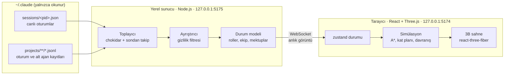

- **Sondan takip:** kayıt dosyaları 40 MB'ı geçebilir; ilk açılışta yalnızca son ~256 KB okunur, sonra yalnızca
  eklenen satırlar 1 MB'lık parçalarla işlenir.
- **Savunmacı ayrıştırma:** bozuk, yarım ya da tanınmayan satırlar atlanır; sunucu asla çökmez.
- **Saf simülasyon:** yol bulma, kat planı ve davranışlar React'tan bağımsız, testli modüllerdir; React yalnızca
  çizer.
- **Performans:** tekrar eden mobilyalar `InstancedMesh` ile çizilir; pencere odakta değilken kare hızı düşer, sekme
  gizliyken çizim durur.

Teknolojiler: Node.js 22, TypeScript (katı mod), `ws`, `chokidar`, Vite, React 19, Three.js,
`@react-three/fiber`, `@react-three/drei`, `@react-three/postprocessing`, zustand, Vitest, Prettier.

## Proje yapısı

```
.
├── server/                 Yerel sunucu: kayıtları izler, durumu hesaplar, tarayıcıya canlı gönderir
│   └── src/
│       ├── main.ts         HTTP + WebSocket sunucusu (127.0.0.1)
│       ├── collector.ts    Dosya izleme ve takipçilerin yönetimi
│       ├── tail.ts         Büyük dosyaları sondan, parça parça okuma
│       ├── parser.ts       Savunmacı ayrıştırıcı ve gizlilik filtresi
│       ├── sessions.ts     Canlı oturum listesi (.key dosyaları hariç)
│       ├── store.ts        Durum modeli (ajanlar, durumlar, mektuplar)
│       ├── roles.ts        Rol çıkarımı
│       ├── roster.ts       Ekip listesi (.claude/agents/*.md, yalnızca ön bilgi)
│       └── demo.ts         Uydurma demo ofisi
├── web/                    Tarayıcı arayüzü (React + Three.js)
│   └── src/
│       ├── App.tsx         Üst çubuk, detay paneli, akış
│       ├── store.ts        Sunucu bağlantısı ve arayüz durumu (zustand)
│       ├── AgentList.tsx   Ajanlar paneli ve filtreler
│       ├── SettingsPanel.tsx  Ayarlar penceresi
│       ├── sound.ts        Kodla üretilen sesli uyarılar
│       └── office/         3B sahne
│           ├── sim/        Saf mantık: A* yol bulma, kat planı, davranış, maskot
│           ├── project/    Proje ofisi: mobilyalar, oda, ekranlar, karakterler, düzenleyici
│           ├── Character.tsx  Eklemli, rol görünümlü karakter
│           ├── themes.ts   Temalar (arayüz + sahne renkleri)
│           └── AllProjectsScene.tsx  "Tüm projeler" görünümü ve uçan mektup
├── shared/types.ts         Sunucu ve arayüzün ortak veri tipleri
├── fixtures/               Testler için uydurma Claude klasörü ve ekip listesi
├── scripts/                Yardımcı betikler (README ekran görüntüleri)
├── web/public/brand/       DevTechnic logosu ve simgesi (yerel dosyalar)
├── docs/                   Belgeler ve ekran görüntüleri
├── PLAN.md                 Yol haritası ve ilerleme günlüğü
└── CLAUDE.md               Claude Code için çalışma kuralları
```

## Geliştirme ve testler

```bash
npm run check   # tip kontrolü + testler
npm run format  # Prettier
```

- TypeScript katı modda (`strict: true`); testler [Vitest](https://vitest.dev/) ile.
- Testler ayrıştırıcıyı, sondan takibi, gizlilik filtresini, rol çıkarımını, bellek budamasını, yol bulmayı, kat
  planını, simülasyonu, temaları ve ayarları kapsar.
- Her `push` ve `pull request`'te GitHub Actions `npm run check` çalıştırır
  ([`.github/workflows/check.yml`](.github/workflows/check.yml)).

## Yol haritası

Ayrıntılı plan ve ilerleme günlüğü: [PLAN.md](PLAN.md).

- [x] Okuyucu, gizlilik filtresi, durum modeli ve canlı yayın
- [x] 3B proje ofisi, rol karakterleri, yol bulma ve canlı davranışlar
- [x] Etkileşim, ayarlar, temalar, düzen düzenleyicisi, maskotlar
- [x] Performans, bellek budaması, düşük güç modu, erişilebilirlik
- [x] **Sürüm 3 · DevTechnic ofisi:** marka duvarı ve tabela, alanların görsel olarak geliştirilmesi, ofisin tüm
      tarayıcı alanını doldurması
- [x] GitHub Pages'te tarayıcıda canlı demo (masaüstü uygulaması düşünüldü, gerek görülmedi: tarayıcı yeterli)

## Katkı

Hata bildirimi, fikir, çeviri ve pull request'ler memnuniyetle karşılanır. Önce [CONTRIBUTING.md](CONTRIBUTING.md)'yi
okuyun; oradaki gizlilik kuralları zorunludur. Başlamak için
[`good first issue`](https://github.com/zinkxx/agent-office/labels/good%20first%20issue) etiketli işlere, planlanan
işler için [yol haritası panosuna](https://github.com/users/zinkxx/projects/7), sorular için
[Discussions](https://github.com/zinkxx/agent-office/discussions)'a bakın. Gizlilik ya da güvenlik sorunu bulursanız
lütfen gizli bildirin: [SECURITY.md](SECURITY.md).

## Lisans

[MIT](LICENSE) · Ayrıntılar `LICENSE` dosyasında.

---

<div align="center">
<sub>Claude Code kayıt biçimi Anthropic tarafından belgelenmiş resmi bir arayüz değildir; Claude Code sürümleriyle
değişebilir. Ayrıntılar: <a href="docs/veri-bicimi.md">docs/veri-bicimi.md</a></sub>
</div>
